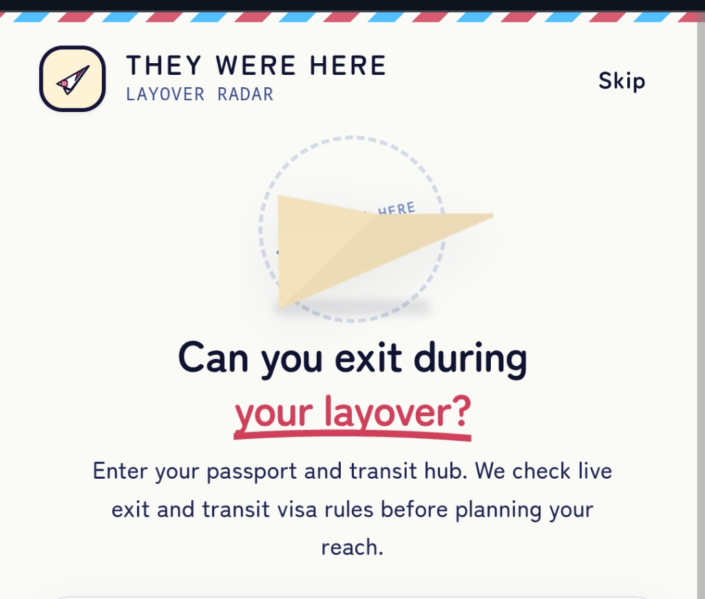
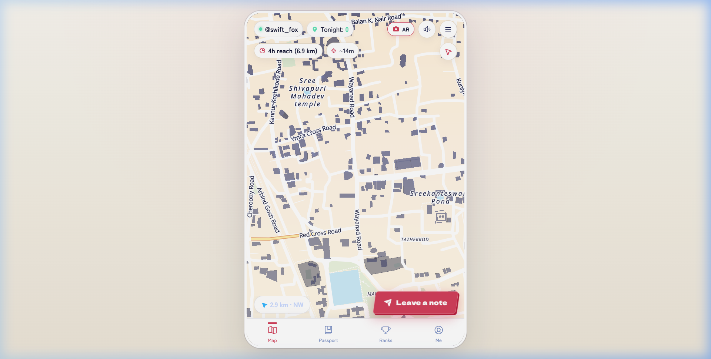
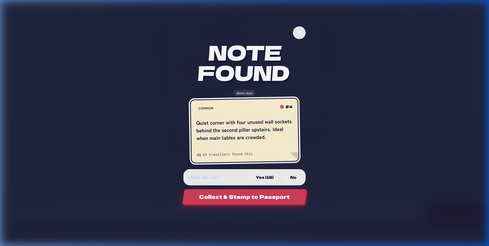
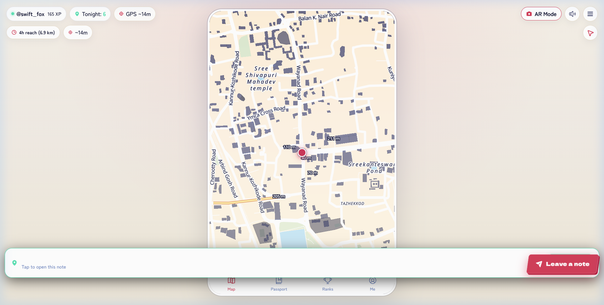

# They Were Here

> Travel advice you can only read by actually standing where somebody left it.

**Live App**: [they-where-here.vercel.app](https://they-where-here.vercel.app/)

<p align="center">
  
</p>

Built for **LAYOVER 2026** by TinkerHub at TinkerSpace Calicut.

---

## What is this?

When you have a four-hour layover in an unfamiliar city, the worst thing you can do is read another SEO listicle written by someone who has never set foot there. 

We built **They Were Here** around a simple physical constraint: **travel advice belongs to the place it was written.** 

If someone sat on the sea wall at Kozhikode Beach, ate pickled raw mango from a cart, and wrote down which vendor had the freshest batch, you shouldn't be able to read that note from a hotel room in another city. You have to walk there. 

You see sealed notes on the map. You walk toward them. When your GPS gets within 40 meters, you break the seal, collect the stamp in your passport, and leave your own note before your train or flight leaves.

---

## Preview

| 2D Radar & Layover Clock | Cinematic Note Reveal | Passport Stamps Collection |
| :---: | :---: | :---: |
|  |  |  |

---

## How It Works

1. **Set your layover time**: Tell the app how long you have before your connection. It calculates your safe walking radius so you don't miss your train or flight.
2. **Find a note on the radar**: Sealed notes glow on the map with distance and walking time.
3. **Walk there**: When you get within 40 meters, the note unlocks.
4. **Cinematic reveal**: Break the seal to read the note, listen to any recorded field voice memos, and collect the stamp.
5. **Vote "Worth the trip?"**: Good notes stay visible. Useless ones fade out.
6. **Drop your own tip**: Pick a stamp, record a 6-second voice tip or write advice, and leave it anchored to the ground for the next traveller.

---

## The Engineering Behind It

### 1. Zero-AI, Server-Authoritative Security
There are no AI features in this app, and no client-side "trust me" checks. 
- Sealed note bodies **never reach the browser** until you are physically inside the unlock radius.
- The client only gets coordinates, rarity, and author handle.
- When you tap to unlock, a Supabase PostGIS RPC (`unlock_note`) verifies your GPS against the note's coordinates with `ST_DWithin`. If you are too far, the server returns nothing. Inspecting the Network tab in DevTools will not give you the note text.
- Row-Level Security (RLS) is enabled on every single table.

### 2. Lightweight Web AR Camera
Mobile browsers rarely support full WebXR 6DoF sessions without native apps. Instead of faking visual odometry:
- We track physical compass heading via `deviceorientationabsolute` and accelerometer tilt.
- Notes are positioned in camera space using relative polar coordinates:
  $$\Delta\theta = ((\text{bearing} - \text{heading} + 540) \bmod 360) - 180$$
- When you pan right, the note moves left on your camera screen. When you walk closer, the GPS distance smoothly scales the 3D origami bird closer to your screen.
- Reticle lock-on uses Normalized Device Coordinate (NDC) projection: aiming your screen's crosshairs directly at the 3D note triggers the audio radar lock and allows one-tap inspection.

### 3. Procedural Web Audio Engine
Airport and station Wi-Fi can be terrible. We don't load megabytes of sound effect MP3s over the network.
- All interface feedback (Hanko stamp thumps, radar sonar pings, melodic unlock arpeggios) is synthesized in real time using the native browser **Web Audio API**.
- Zero audio assets downloaded. Instant zero-latency sound effects offline.

### 4. Offline First & Open-Source Maps
- Vector map rendering powered by **MapLibre GL JS** using OpenFreeMap and OpenStreetMap data.
- Works offline for notes already stamped into your travel passport via local indexedDB caching.

---

## Tech Stack

| Layer | Tools |
| :--- | :--- |
| **Framework** | React 19, TypeScript, Vite |
| **Styling** | Vanilla CSS Tokens, Tailwind CSS v4, Phosphor Icons |
| **Mapping** | MapLibre GL JS, OpenFreeMap, OpenStreetMap |
| **3D & AR** | Three.js (WebGL polar geo-anchoring) |
| **Audio** | Web Audio API (procedural synthesis) + MediaRecorder |
| **Backend & DB** | Supabase (PostgreSQL 15, PostGIS, RLS, SECURITY DEFINER RPCs) |
| **State** | Zustand |
| **Router** | Wouter |
| **Deployment** | Vercel (Progressive Web App) |

---

## Getting Started Locally

### Prerequisites
- Node.js 20+
- npm or pnpm

### Setup

```bash
# Clone the repository
git clone https://github.com/stippusahib/They_Where_Here.git
cd "They_Where_Here"

# Install dependencies
npm install

# Set up environment variables
cp .env.example .env.local
```

Add your Supabase credentials to `.env.local`:
```ini
VITE_SUPABASE_URL=https://your-project.supabase.co
VITE_SUPABASE_ANON_KEY=your-anon-publishable-key
```

### Run Dev Server

```bash
npm run dev
```

Open `http://localhost:5173` in your mobile browser or DevTools device mode.

### Production Build

```bash
npm run build
npm run preview
```

---

## Honest Limitations

- **Web GPS Spoofing**: Since this is a browser PWA, skilled users can spoof coordinates using browser DevTools. We mitigate this with server-side speed checks, teleportation jump detection, and rate limits. A native mobile shell with hardware mock-location detection would be the next step.
- **Indoor Satellite Shadowing**: High-accuracy GPS requires an open view of the sky. If you are deep inside an underground subway terminal or concrete concourse, GPS accuracy degrades to ±30m. The app warns you when accuracy drops below 15m.
- **Anonymous Session Persistence**: We intentionally do not collect email addresses, phone numbers, or passwords. Your identity is a local anonymous key. If you wipe your browser cache completely, your local passport is cleared unless exported.

---

## Credits & License

Built with care for **LAYOVER 2026** by:
- **Alfie** 
- **Tippu**
 
Full third-party licenses, font open-source details (OFL 1.1), and OpenStreetMap attributions are documented in [CREDITS.md](CREDITS.md).
